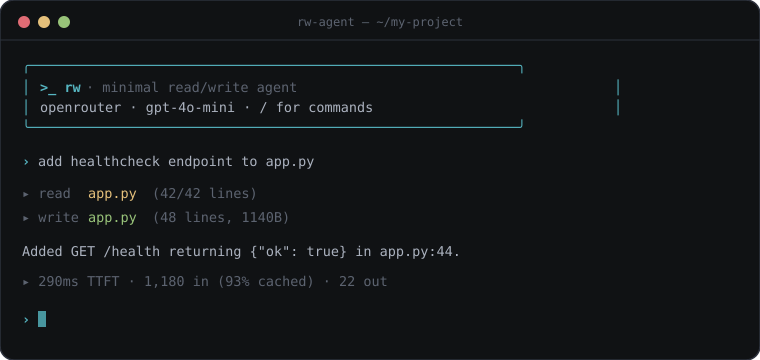

<div align="center">

```
██████╗ ██╗    ██╗
██╔══██╗██║    ██║
██████╔╝██║ █╗ ██║
██╔══██╗██║███╗██║
██║  ██║╚███╔███╔╝
╚═╝  ╚═╝ ╚══╝╚══╝
```

# `rw-agent`

**Ultra-minimal, speed-focused AI file agent.**  
Only **two tools** (`read`, `write`). Static prefix for **maximum prompt-cache hit rate**. Zero bloat.

[](LICENSE)
[](https://www.python.org/)
[](#architecture)

<br/>



</div>

---

## Install

### macOS / Linux / Termux (Android)
```bash
curl -fsSL https://raw.githubusercontent.com/Gl1ch5/rw-agent/main/install.sh | bash
```

> **Termux:** auto-detected — installs `python` + `git` via `pkg` if needed and links `rw` into `$PREFIX/bin` (no `uv` required).

### Windows (PowerShell)
```powershell
irm https://raw.githubusercontent.com/Gl1ch5/rw-agent/main/install.ps1 | iex
```

### Via `uv` (any OS)
```bash
uv tool install git+https://github.com/Gl1ch5/rw-agent.git
```

---

## First Launch

Run `rw` in any directory:

```bash
rw
```

On first launch, `rw` walks you through a **3-field custom OpenAI-compatible setup**:

1. **API URL** — e.g. `https://api.openai.com/v1`, `https://openrouter.ai/api/v1`, or `http://localhost:11434/v1`
2. **API Key** — masked input (press `Enter` to skip for local servers)
3. **Provider Name** — e.g. `openrouter`, `openai`, `local`

`rw` immediately **syncs `/models`**, saves your config (`~/.rw-agent/config.json`, `0600`), auto-selects the first model, and drops you straight into chat — no extra model-selection step required.

---

## Why `rw`?

- **Only `read` and `write`** — ~120 tokens of tool schemas instead of thousands. The model spends zero time deciding between 20 redundant tools.
- **High Cache Hit-Rate** — 100% static system prompt (~60 tokens) and immutable tool definitions at the prefix, plus append-only message history. Prefix/KV caches hit consistently on every follow-up turn.
- **Live Streaming & Animations** — real-time token streaming, animated spinners during TTFT and file ops, and a compact telemetry line (`▸ 290ms TTFT · 1,420 in (92% cached) · 58 out`).
- **Instant `/` Command Menu** — type `/` to open the live command dropdown.

---

## Slash Commands

| Command | Action |
| :--- | :--- |
| `/model` | Interactive fuzzy-filter model picker from synced models |
| `/new` | Start a new chat (clears context, keeps static prefix warm) |
| `/provider` | Add or reconfigure a custom OpenAI-compatible provider |
| `/exit` | Quit `rw` |

---

## One-Shot Mode

```bash
rw "read src/app.py and add type hints"
```

---

## Architecture

```
src/rw_agent/
├── cli.py      # REPL loop, streaming output, tool loop, telemetry
├── client.py   # SSE streaming client + cache-hit & TTFT tracking
├── config.py   # ~/.rw-agent/config.json + /models auto-sync
├── tools.py    # Static system prompt + read/write tools only
└── ui.py       # Onboarding wizard, / slash completer, model picker
```

---

<div align="center">
<sub>MIT © <a href="https://github.com/Gl1ch5">Gl1ch5</a></sub>
</div>
